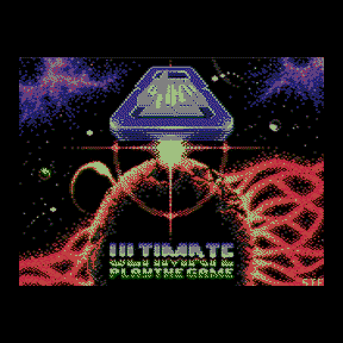
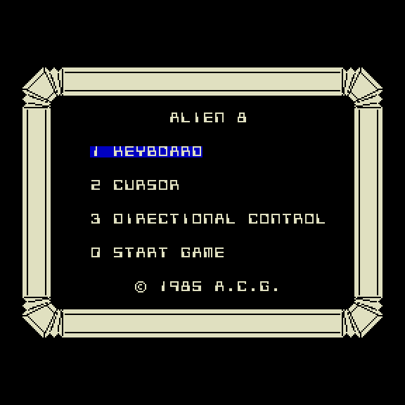
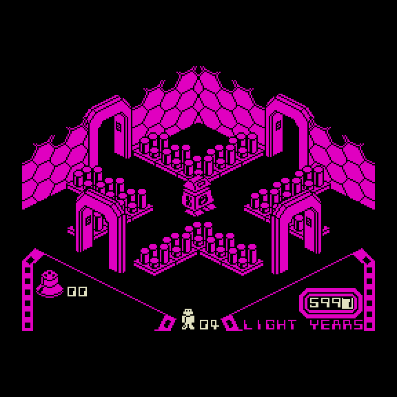
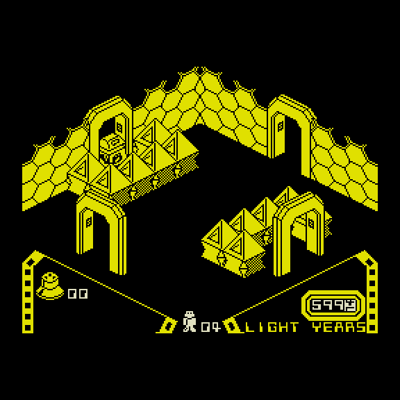
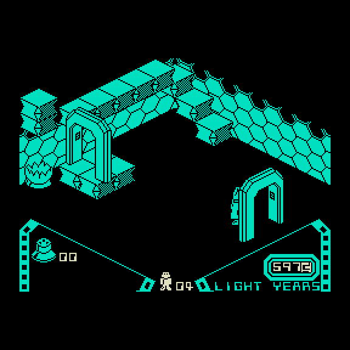

# Alien 8 для Вектора-06Ц

Порт игры **Alien 8** (Ultimate Play The Game, 1985, ZX Spectrum) на обычный
**Вектор-06Ц**: КР580ВМ80А (i8080) 3 МГц, 64 КБ, без Z80-платы и квазидиска. Код игры —
рекомпиляция дизассемблера ZX (tcdev) из Z80 в i8080 по рецепту, отработанному на Knight Lore;
логика сверена с оригиналом ZX итерация в итерацию, картинка — побайтно.

| Заставка | Меню | Стартовая комната |
|---|---|---|
|  |  |  |

| Другие комнаты | |
|---|---|
|  |  |

## Готовые образы

| Файл | Что это |
|---|---|
| [`rom/alien8.r0m`](rom/alien8.r0m) | итоговый релиз: 16-цветная заставка на весь экран с мелодией C64, игра на время заставки сжата и распаковывается по клавише |
| [`rom/alien8-nosplash.r0m`](rom/alien8-nosplash.r0m) | та же игра без заставки — сразу меню |
| [`rom/alien8-0100.rom`](rom/alien8-0100.rom) | та же игра без заставки, образ **с 0x0100** (26 219 Б): обычный `.rom` и Турбо+ из CP/M |

Образы `.r0m` — снимки памяти 64 КБ, которые грузятся **с адреса 0x0000**: так их берут ядро
Vector-06C на MiSTer и эмуляторы, понимающие этот формат. Игра занимает всю память, включая
нулевую страницу.
Образ `-0100.rom` — для загрузчиков, которые кладут программу с 0x0100: обычный `.rom`
Вектора и CP/M Вектора Турбо+ (скопировать на диск как `ИМЯ.COM` и запустить `ИМЯ -V T3`).
Внутри — тот же снимок без заставки, сжатый ZX0, и маленький распаковщик (`tools/mkcom.py`):
он переносит себя в 0xFD00 (таблицы сдвига 0xF100..0xFFFF игра всё равно строит заново),
раскладывает снимок по всей памяти, включая нулевую страницу, и уходит на 0x0000 — как после
сброса. Проверка `tools/comgate_vec.js`: память в момент перехода байт в байт равна снимку.
Проверено в эмуляторе Турбо+ (vturbo-js, CP/M, `-V T3`): меню, старт, игра идёт.

## Управление

Раскладка выбирается в меню клавишами **1/2/3**, **0** — старт.

| Раскладка | Влево / вправо (поворот) | Вперёд | Прыжок | Взять / бросить |
|---|---|---|---|---|
| 1 KEYBOARD (как в оригинале) | Z C B M / X V N | A S D F G H J K L | Q W E R T Y U I O P | цифры 0–9 |
| 2 CURSOR | ← / → | ↑ | пробел | ↓ |
| 3 DIRECTIONAL CONTROL | стрелки — направление движения | | пробел | цифры 0–7 |

**ВК** — пауза.

**Джойстик «П»** (порт 6 за портом 5 = 9Fh, читаются оба устройства): работает во всех трёх
раскладках вместе с клавиатурой. Направления — как стрелки, огонь 1 — прыжок, огонь 2 —
взять/бросить; любая кнопка в меню — старт игры, на заставке — пропуск. Чтение нормируется
значением покоя, замеренным при старте, а мусор на шине (биты 4–5) считается «ничего не нажато».

**Читов нет** ни в игре, ни в сборке. Для стендов есть только переменные сборки (`A8_*`),
игроку они не нужны.

## Сборка

Нужны Python 3 и компилятор C (собирает упаковщик zx0 из `tools/zx0`). Ассемблер
[sjasmplus](https://github.com/z00m128/sjasmplus) 1.24 вложен в `tools/sjasmplus`, но это сборка
**под macOS arm64**; на другой машине передайте свой: `SJASMPLUS=sjasmplus ./build.sh roms`.

```sh
./build.sh roms      # rom/alien8.r0m, rom/alien8-nosplash.r0m и rom/alien8-0100.rom
```

Цели по отдельности: `./build.sh vec` (игра без заставки, `build/alien8_vec.r0m`),
`./build.sh release` (эталон и итоговый релиз в `build/`), `./build.sh lockstep` (логика 1:1 для
сверки с ZX). Цель `./build.sh zx` (сборка ZX-оригинала из листинга tcdev с проверкой «байт в
байт») и стенды сверки с ZX требуют исследовательскую папку с образами оригинала — путь в
`A8_RESEARCH` (по умолчанию `~/projects/alien8-research`); для готовых образов она не нужна.

## Проверки

Стенды на JS гоняют образ в эмуляторе [vector06js](https://github.com/svofski/vector06js) —
путь к клону в `V06` (по умолчанию `~/projects/vector06js`).

```sh
python3 tools/gatecheck.py        # САМОПРОВЕРКА: в каждый из 27 гейтов вносится своя порча
                                  # (41 штука), гейт обязан её поймать; дерево должно быть чистым
node tools/inputcheck_vec.js build/alien8_vec.r0m build/alien8_vec.sld   # клавиатура, меню, пауза, джойстик «П»
```

Состав гейтов, команды и числа — в [docs/DEVLOG.md](docs/DEVLOG.md) (журнал состояния) и
[docs/PORT_RECIPE.md](docs/PORT_RECIPE.md) (полный журнал порта); план по скорости —
[docs/SPEED_PLAN.md](docs/SPEED_PLAN.md); рабочие файлы задачи «заставка» —
[docs/archive/splash-task2/](docs/archive/splash-task2/).

## Что не сделано

* элементы, которые на ZX ярко-красные (атрибут 0x42), и счётчик LIGHT YEARS выходят цветом
  комнаты (одна плоскость — одно перо);
* мелодии MSX в меню (ветка `splash-laguna`, не закончена);
* лицензия распаковщика dzx0 для 8080 (`tools/dezx`, производная от BSD-3 ZX0) у автора не
  уточнена.

## Источники

Alien 8 © 1985 Ultimate Play The Game. Дизассемблер ZX — tcdev. Упаковщик zx0 — Einar Saukas
(BSD-3, `tools/zx0/LICENSE`), распаковщик для 8080 — Ivan Gorodetsky (`tools/dezx`).
